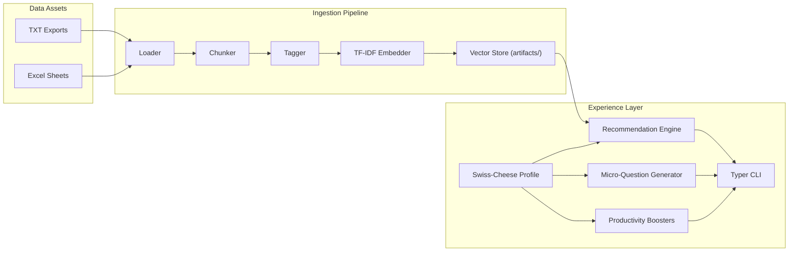

# S³ — Skoda Smart Stream


AI-native skill acceleration for Škoda employees. S³ reframes learning as an on-demand puzzle: the system understands what each person already knows, surfaces the exact missing skills, and delivers ultra-short interventions that translate into productivity gains the same day.

## Team
- Organization: 42 Heilbronn × 42 Prague
- Members: `________`, `________`, `________`, `________`, `________`

## Problem
- Training libraries are huge, but employees only need ~10 % of each course to unblock their work.
- Annual exams are outdated: they miss real knowledge gaps that appear in day-to-day tasks.
- Productivity tools exist (Copilot, templates, macros) but employees rarely discover or adopt them.

## Solution Highlights
- **Learning as a Puzzle** – Decompose legacy courses into 3–5 minute, AI-tagged chunks so only the missing pieces are assigned.
- **Dynamic Diagnostics** – Weekly or task-triggered micro-questions verify skills in-context, immediately linking to the right nugget when a gap is detected.
- **Productivity Booster** – When a skill is already strong, the agent recommends accelerators (templates, copilots, automations) rather than more learning hours.

## Technical Blueprint
1. **Content Granulation**
   - Parse source courses/transcripts (see `data/`).
   - Use the included chunker + tagger to convert raw exports into micro-modules.
2. **Swiss-Cheese Profiles**
   - Store user evidence (`verified`, `inferred`, `unknown`) per skill.
   - Visualize gaps as “holes” that must be filled before the next project milestone.
3. **Recommendation Engine**
   - Maintain a vector store of chunk embeddings + metadata.
   - Retrieve the smallest set of chunks that cover open holes while respecting time constraints.
4. **Micro-Diagnostics Loop**
   - Generate micro-scenarios tied to active tasks.
   - Route answers into the profile (verified vs. needs help) and trigger targeted nudges.
5. **Delivery Layer**
   - Playlist view for upcoming micro-modules.
   - Productivity tips surfaced when confidence is high but better tools exist.

## Architecture Diagram


## Project Layout
```
.
├── data/                # Provided hackathon exports (raw, unchanged)
├── artifacts/           # Auto-generated embeddings/vector store
├── src/s3/              # Python package with pipeline + demo CLI
├── pyproject.toml       # Poetry configuration
└── README.md
```

## Running the Prototype

1. **Install dependencies**
   ```bash
   cd /Users/pixo/Documents/Coding/Skoda
   poetry install
   ```
2. **Ingest the dataset**
   ```bash
   poetry run python -m s3.cli run-ingest
   ```
   This reads `data/`, builds micro-chunks with tags, and stores embeddings under `artifacts/vector_store/`.
3. **Demo the experience**
   ```bash
   poetry run python -m s3.cli demo anna
   ```
   The CLI prints recommended chunks (puzzle pieces), micro-questions (dynamic diagnostics), and productivity boosters for a sample persona.

## Dataset Notes
- Raw hackathon exports live in `data/`.
- Keep original filenames for traceability; derived/cleaned artifacts should go under `data/processed/` (to be created).
- Recommended first steps:
  - Inspect structure (`.txt`, `.xlsx`, `.pdf`).
  - Draft a schema for skills, tags, and user signals.
  - Build a data dictionary to map source columns to the unified profile.

## Hackathon Plan of Attack
1. **Day 1** – Data audit, schema design, quick-and-dirty chunking script, placeholder embeddings.
2. **Day 2** – Mock user profiles, retrieval scoring, micro-question generator, basic UI storyboard.
3. **Final Stretch** – Polish pitch: show “Anna” scenario, Swiss-cheese visualization, and productivity booster demo.

## Pitch Soundbites
- “We cut training waste by removing what people already know.”
- “Micro-questions keep diagnostics alive and painless.”
- “From Just-in-Case learning to Just-in-Time performance.”

## Next Steps
- Connect the heuristic tagger to a hosted LLM for richer skill metadata.
- Replace TF-IDF with sentence transformers to improve retrieval precision.
- Add a Streamlit or web UI that mirrors the CLI scenario for judges.

## License
Released under the terms described in `LICENSE`.

